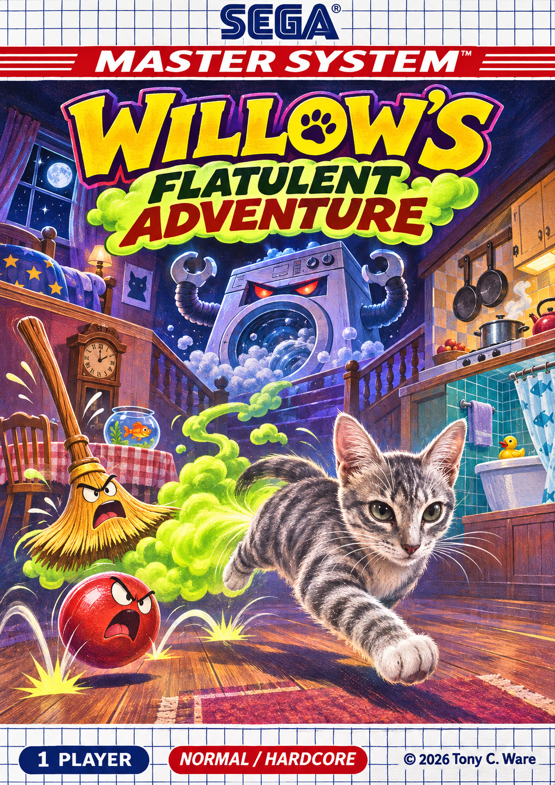

# Willow's Flatulent Adventure

**Un videojuego original para SEGA Master System — © 2026 Tony C. Ware**



## Historia

> Usted es Willow, la gata de la familia.
>
> Es de noche y la casa se ha vuelto loca. Las pelotas de goma botan sin parar, la vieja escoba ha cobrado vida y la lavadora del baño ruge con hambre de calcetines. Willow, la gata de la casa, tiene muy pocas ganas de que le fastidien su sueñecito...
>
> Así que va a recorrer las cuatro habitaciones principales con su arma más temible: sus pedos.

## Jugar

Descarga la ROM `Willows_Flatulent_Adventure.sms` de [Releases](../../releases) y ábrela en un emulador compatible con SEGA Master System o en hardware compatible que admita ROMs.

- **Moverse:** cruceta.
- **Comenzar:** botón 1.
- **Dificultad:** seleccionar Normal o Hardcore con arriba/abajo desde la pantalla de título.
- **Pausa:** botón PAUSE de Master System.

Consulta [el atlas e instrucciones](Willow_Atlas_e_Instrucciones.pdf) para los detalles de juego.

## Código fuente

El proyecto contiene el ensamblador Z80 y las herramientas propias de generación de gráficos, niveles y sonido. Para reconstruir la ROM, desde `Banco_de_trabajo/willow` ejecuta:

```sh
sh build.sh
```

Se necesita Python 3; el script utiliza el ensamblador incluido en `tools/zasm.py`. La salida es `build/willow.sms`.

**Verificación V1.0:** SHA-256 `10f420975e654e1cbc8b7e6477b3e428d457e53668941cd42dbcd0fd5458e9cd`.

## Contenido

- `Caratula.png`: carátula oficial.
- `Willows_Flatulent_Adventure.sms`: ROM lista para jugar.
- `Willow_Atlas_e_Instrucciones.pdf`: atlas e instrucciones.
- `Banco_de_trabajo/willow/`: fuentes y herramientas.
- `Banda_sonora/`: temas musicales exportados.

## Autoría y licencia

© 2026 **Tony C. Ware**. El repositorio contiene un archivo `LICENSE` con licencia MIT; revisa su texto exacto para conocer el alcance de los derechos concedidos. La presencia de material gráfico, sonoro o de marcas de terceros no supone que se conceda licencia sobre ellos.

SEGA y Master System son marcas de sus respectivos titulares. Proyecto independiente, sin afiliación ni respaldo oficial.
